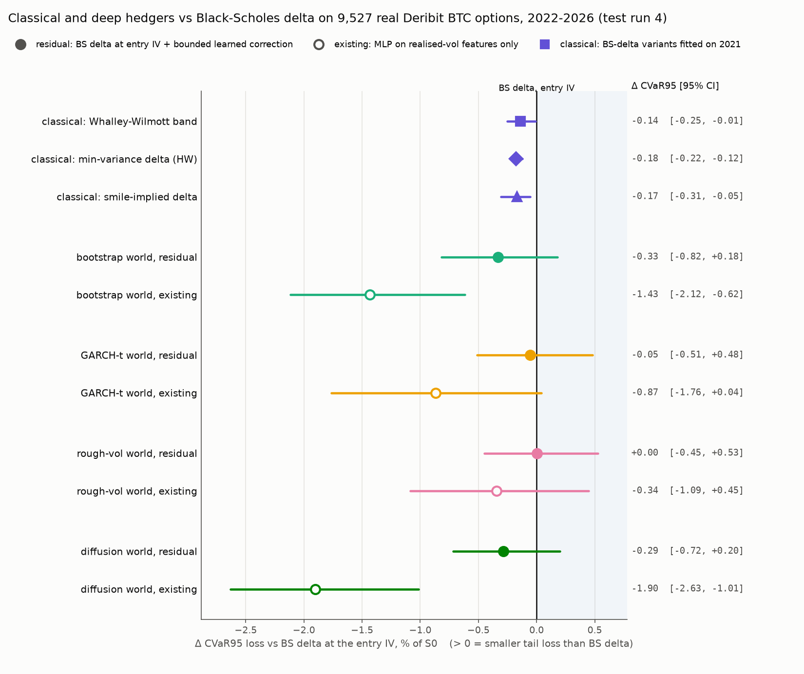

# Deep hedging BTC options: which simulated market holds up on real Deribit options?

[](https://github.com/mohymabrouk/deep-hedging-sim-to-real/actions/workflows/tests.yml)

**Headline.** On **9,527 real Deribit BTC options** that expired between January 2022 and October 2026, hedged once a
day with the Binance perpetual after fees and funding, **no deep hedger beats Black-Scholes delta** at the option's
implied vol. That includes four residual hedgers added in test run 3, which start from that very delta and learn a
bounded correction.
- The best residual hedger, trained in the **rough-volatility** world, ties BS delta. Its CVaR95 loss is 3.63% of
  spot against 3.64%; the difference is +0.00, with a 95% interval of [-0.45, +0.53].
- The other three residual hedgers are 0.05 to 0.33 worse in CVaR95, none significantly. All four have a
  significantly wider loss distribution than BS delta: their standard deviation of loss is 0.23 to 0.32 higher.
- Starting from BS delta removes most of the tail-loss gap of the original deep hedgers. In the diffusion world it
  shrinks from -1.90 to -0.29. But the gap does not turn into an edge.
- The seven original hedgers were not retrained, and their run-2 numbers reproduce up to floating-point noise.



## Results

Every number comes from `results/` (`tables.md` holds all tables at three decimals). The latest test run is **run 3 of
3**: a forced rerun that adds the four residual hedgers. It was logged at 2026-11-22 14:15 UTC with config hash
`d35f2054d7c27041`, the hash frozen before the residual policies were retrained, and the test stage refuses to run if
the two differ. Runs 1 and 2 are archived in `results/run1_official/` and `results/run2_official/`.

Losses are in **% of S0**, the BTC index at entry, for a short option on 1 BTC. CVaR95 is the average of the worst 5%
of losses. Δ is BS delta's loss minus the hedger's loss, so **Δ > 0 means better than BS delta**. The 95% intervals come
from a moving-block bootstrap over expiry dates: blocks of 4 expiries, 2,000 resamples.

### Test options, run 3, 1x fees (9,527 options, 251 expiries)

| Hedger | Mean P&L | Std of loss | CVaR95 loss | Δ CVaR95 vs BS delta [95% CI] | Δ mean loss vs BS delta [95% CI] | Turnover |
|---|---|---|---|---|---|---|
| No hedge | 0.15 | 6.11 | 19.80 | -16.16 [-19.69, -12.50] | -0.05 [-0.42, +0.31] | 0.00 |
| **BS delta, entry IV** | 0.20 | 1.42 | **3.64** | benchmark | benchmark | 1.63 |
| BS delta, IV moved by DVOL | 0.20 | 1.41 | 3.59 | +0.04 [-0.10, +0.20] | +0.00 [-0.01, +0.02] | 1.63 |
| Deep hedge, bootstrap world | 0.18 | 2.13 | 5.07 | -1.43 [-2.12, -0.62] | -0.02 [-0.15, +0.11] | 1.35 |
| Deep hedge, GARCH-t world | 0.22 | 1.97 | 4.51 | -0.87 [-1.76, +0.04] | +0.02 [-0.09, +0.13] | 1.56 |
| Deep hedge, rough-vol world | 0.20 | 1.71 | 3.98 | -0.34 [-1.09, +0.45] | -0.00 [-0.08, +0.08] | 1.54 |
| Deep hedge, diffusion world | 0.18 | 2.18 | 5.54 | -1.90 [-2.63, -1.01] | -0.01 [-0.13, +0.11] | 1.29 |
| Residual deep hedge, bootstrap world | 0.25 | 1.68 | 3.97 | -0.33 [-0.82, +0.18] | +0.05 [-0.06, +0.16] | 1.53 |
| Residual deep hedge, GARCH-t world | 0.19 | 1.74 | 3.69 | -0.05 [-0.51, +0.48] | -0.01 [-0.07, +0.06] | 1.55 |
| **Residual deep hedge, rough-vol world** | 0.20 | 1.69 | **3.63** | +0.00 [-0.45, +0.53] | -0.00 [-0.07, +0.06] | 1.52 |
| Residual deep hedge, diffusion world | 0.21 | 1.65 | 3.93 | -0.29 [-0.72, +0.20] | +0.02 [-0.06, +0.09] | 1.42 |

**What the residual hedgers do.**
- **Trading.** They trade 5-12% less than BS delta (turnover 1.42-1.55 against 1.63).
- **Size of the correction.** On the test options their correction at entry averages 0.06 to 0.09 BTC per option
  (`results/test_entry_hedge_ratios.csv`). For the three policies with c = 0.1 it is often at the bound: the 95th
  percentile is 0.097-0.100.
- **Result.** The tail loss ends up close to BS delta's, but the loss is more dispersed. The change in standard
  deviation vs BS delta is between -0.23 and -0.32 for all four, each with a 95% interval below zero.

### Run 2 vs run 3 (test options, 1x fees)

| Hedger | Run 2: CVaR95 loss | Run 2: Δ CVaR95 vs BS delta [95% CI] | Run 3: CVaR95 loss | Run 3: Δ CVaR95 vs BS delta [95% CI] |
|---|---|---|---|---|
| No hedge | 19.80 | -16.16 [-19.69, -12.50] | 19.80 | -16.16 [-19.69, -12.50] |
| BS delta, entry IV | 3.64 | benchmark | 3.64 | benchmark |
| BS delta, IV moved by DVOL | 3.59 | +0.04 [-0.10, +0.20] | 3.59 | +0.04 [-0.10, +0.20] |
| Deep hedge, bootstrap world | 5.07 | -1.43 [-2.12, -0.62] | 5.07 | -1.43 [-2.12, -0.62] |
| Deep hedge, GARCH-t world | 4.51 | -0.87 [-1.76, +0.04] | 4.51 | -0.87 [-1.76, +0.04] |
| Deep hedge, rough-vol world | 3.98 | -0.34 [-1.09, +0.45] | 3.98 | -0.34 [-1.09, +0.45] |
| Deep hedge, diffusion world | 5.54 | -1.90 [-2.63, -1.01] | 5.54 | -1.90 [-2.63, -1.01] |
| Residual deep hedge, bootstrap world | not run | not run | 3.97 | -0.33 [-0.82, +0.18] |
| Residual deep hedge, GARCH-t world | not run | not run | 3.69 | -0.05 [-0.51, +0.48] |
| Residual deep hedge, rough-vol world | not run | not run | 3.63 | +0.00 [-0.45, +0.53] |
| Residual deep hedge, diffusion world | not run | not run | 3.93 | -0.29 [-0.72, +0.20] |

**Reproduction check** (`results/reproduction_vs_run2.csv`, also in `tables.md`). The seven original hedgers use the
same policy files as in run 2 (byte-identical copies are in `models/run2_official/`).
- **Benchmarks.** No hedge, BS delta and BS-DVOL reproduce run 2 bit for bit.
- **The four original deep hedgers** differ from run 2 by at most:
  - 1.7e-10 (% of S0) in any summary statistic, confidence bounds included;
  - 6.8e-10 in the split and fee tables;
  - 7.2e-7 in any single option's P&L.
- **Why they differ at all.** These are float32 rounding differences in the network. Run 3 ran with 2 CPU threads,
  and a different thread count changes the order of floating-point sums.

### CVaR95 loss by period, option type and fee level (run 3)

Fee levels apply to the same positions; the policies are not retrained.

| Hedger | 2022-23 (3,049) | 2024 on (6,478) | Calls (4,840) | Puts (4,687) | Fees x0 | Fees x1 | Fees x2 |
|---|---|---|---|---|---|---|---|
| No hedge | 20.69 | 19.35 | 22.66 | 16.50 | 19.77 | 19.80 | 19.83 |
| BS delta, entry IV | 3.75 | 3.57 | 3.83 | 3.42 | 3.48 | 3.64 | 3.80 |
| BS delta, IV moved by DVOL | 3.68 | 3.52 | 3.82 | 3.35 | 3.44 | 3.59 | 3.75 |
| Deep hedge, bootstrap world | 5.03 | 5.09 | 5.37 | 4.75 | 4.93 | 5.07 | 5.21 |
| Deep hedge, GARCH-t world | 4.59 | 4.46 | 5.07 | 3.71 | 4.40 | 4.51 | 4.62 |
| Deep hedge, rough-vol world | 3.94 | 3.99 | 4.33 | 3.58 | 3.86 | 3.98 | 4.11 |
| Deep hedge, diffusion world | 5.56 | 5.53 | 5.88 | 5.18 | 5.40 | 5.54 | 5.68 |
| Residual deep hedge, bootstrap world | 4.04 | 3.93 | 3.56 | 4.25 | 3.83 | 3.97 | 4.11 |
| Residual deep hedge, GARCH-t world | 3.80 | 3.63 | 3.89 | 3.47 | 3.57 | 3.69 | 3.82 |
| Residual deep hedge, rough-vol world | 3.72 | 3.58 | 3.91 | 3.31 | 3.51 | 3.63 | 3.76 |
| Residual deep hedge, diffusion world | 3.91 | 3.93 | 3.93 | 3.91 | 3.79 | 3.93 | 4.07 |

- **No residual hedger is significantly better than BS delta in any split.** The paired intervals for each split are
  in `tables.md`. One residual cell is significantly worse: the bootstrap-world residual hedger on puts, -0.83
  [-1.36, -0.22].
- **The rough-vol residual hedger is the only one with a lower CVaR95 than BS delta on puts:** 3.31 against 3.42,
  Δ +0.11 [-0.40, +0.66]. It is not significant, and it is worse on calls (3.91 against 3.83).
- **Original deep hedgers.** Their ranking holds in every column, as in run 2. The bootstrap and diffusion policies
  are significantly worse than BS delta in all four splits, and the GARCH-t policy is on calls.
- **Correction to the run-2 README.** It showed 3.69 for BS-DVOL in 2022-23; the file value is 3.685, now rounded to
  3.68.

### Simulator realism: worlds fitted on 2018-2021 vs real daily returns from 2022

| Series | Annual vol | Excess kurtosis | Mean ACF of \|r\|, lags 1-10 | 1% quantile | 99% quantile | W1, standardised |
|---|---|---|---|---|---|---|
| Real BTC, 2022 on | 0.49 | 3.2 | 0.107 | -0.082 | 0.072 | n/a |
| Bootstrap | 0.80 | 7.1 | 0.103 | -0.130 | 0.113 | 0.046 |
| GARCH-t | 0.81 | 22.1 | 0.160 | -0.122 | 0.120 | 0.105 |
| Rough vol | 0.82 | 6.7 | 0.162 | -0.126 | 0.116 | 0.046 |
| Diffusion | 0.80 | 36.6 | 0.224 | -0.124 | 0.113 | 0.172 |

- **The regime shift is large.** All four worlds learn from 2018-2021, so they are 60-70% more volatile than BTC
  was in 2022-2026 (annual vol 0.80-0.82 against 0.49).
- **The diffusion model is mixed.** Its raw return distribution is the closest to the real one (W1 0.0057, see
  `results/realism.csv`), but it has the heaviest tails and the most volatility clustering.
- **These statistics do not predict hedging quality.** Bootstrap and rough vol are equally close in standardised
  shape (0.046), yet the original rough-vol policy hedges far better than the bootstrap one (3.98 vs 5.07).

### Run 1 vs run 2 (GARCH only)

| Run | Logged (UTC) | Config hash | GARCH shocks | GARCH CVaR95 loss | Δ CVaR95 vs BS delta [95% CI] |
|---|---|---|---|---|---|
| 1, official | 2026-11-19 09:41 | `d2f906a2dba41748` | uncapped Student-t | 20.15 | -16.51 [-20.78, -11.13] |
| 2, forced rerun | 2026-11-21 20:24 | `152ac45c09422193` | capped at the largest in-sample residual (8.2 sd) | 4.51 | -0.87 [-1.76, +0.04] |

**What went wrong in run 1.** In the final-stage GARCH world, one Student-t draw of about 150 sd produced a +12 daily
log return.
- The drift correction is log E[exp(r)], so that single value set it to 0.115 per day.
- Every path then fell about 97% in 35 days.
- The policy learned to barely hedge calls, and its row matched "no hedge".

**How the fix was made.** The defect shows in the simulator's own output
(`results/run1_official/simulators/final_garch.json`), not only in the test scores. The fix:
1. Truncate standardised shocks at the largest in-sample residual.
2. Redo the GARCH validation on 2021 options; alpha = 0.9 was chosen again.
3. Retrain the final GARCH policy.
4. Rerun the test with `--force`, which is logged as `forced_rerun: true`.

**Checks.**
- The other six hedgers gave the same numbers in runs 1 and 2, up to floating-point noise: at most 4e-9 (% of S0) in
  any summary statistic and 1e-6 in any single option's P&L.
- `tests/test_sims.py` fails on the uncapped sampler: the pipeline's own seed reproduces the 0.115 shift.

Because run 2 came after run 1 was seen, read the GARCH row as less clean than the others.

### More figures

- `results/fig_paired_improvement.png`: paired change in mean loss and CVaR95 loss vs BS delta, every hedger except no
  hedge.
- `results/fig_pnl_distributions.png`: loss distributions and right-tail quantiles, one row per deep-hedger family.
- `results/fig_hedge_ratio_vs_moneyness.png`: hedge ratio at entry vs moneyness, deep policies vs BS delta, one row
  per family.

## Method

**Question.** A deep-hedging policy (Buehler, Gonon, Teichmann & Wood, *Deep hedging*, Quantitative Finance
19(8), 2019) is only as good as the market it was trained in. Four training markets are compared, and every
policy is scored on the same thing: **real expired Deribit BTC options, hedged with the Binance USDT-M perpetual,
after fees and funding**.

**Training markets** (all fitted on Binance spot BTCUSDT daily 08:00-UTC log returns from 2018-01-02; every
generator is shifted so that E[exp(r)] = 1, a driftless price, so the policies learn to hedge rather than to bet on
the 2018-2021 trend):

| World | Model | Fitted parameters (final stage, data <= 2021-12-31) |
|---|---|---|
| (a) bootstrap | stationary block bootstrap (Politis & Romano), mean block 20 days | `results/simulators/final_bootstrap.json` |
| (b) GARCH-t | GARCH(1,1), zero mean, standardised Student-t, MLE with `arch`; each path starts from an in-sample filtered variance; conditional variance capped at the in-sample maximum (the fit is integrated, alpha + beta = 1, and uncapped paths exploded); standardised shocks truncated at the largest in-sample standardised residual (run 2 onwards) | `results/simulators/final_garch.json` |
| (c) rough vol | RFSV (Gatheral, Jaisson & Rosenbaum 2018, the P-model behind rough Bergomi): log-vol is a fractional OU process; H and vol-of-vol from the regression of log E[(log sigma_{t+D} - log sigma_t)^2] on log D, D = 1..30 days, with daily realised variance from 5-minute returns; leverage rho from corr(r_t/sqrt(RV_t), d log RV_{t+1}) | `results/simulators/final_rough.json` |
| (d) diffusion | DDPM, 1D U-Net with 1.09M parameters, cosine schedule (1,000 levels), DDIM sampling (50 steps, predicted clean window clipped at +-15 sd), trained on 64-day windows of standardised daily log returns taken at all 24 hourly anchors | `results/simulators/final_diffusion.json` |

**Original policy (runs 1-3).** One MLP (3 x 64, SiLU) shared by every contract.
- **Inputs at day t**, all computed from data <= t: log(S_t/K), time to expiry, the current hedge, 10-day realised
  vol (annualised, from daily 08:00 returns), a call/put flag, and z = log(S/K)/(rv sqrt(tau)) clipped to +-4 (a
  function of the other inputs).
- **Output.** A hedge ratio in [0, 1] for calls, [-1, 0] for puts (sigmoid).
- **Objective.** CVaR_alpha of the loss of a short option hedged with proportional costs (0.05% per trade),
  Rockafellar-Uryasev form.
- **Training contracts.** Maturity uniform on 7..35 days, log(K/S0) uniform on [-0.2, 0.2], half calls.
- **Budget.** 20,000 simulated 64-day paths per world, Adam, batch 4,096, 1,500 steps (about 4 minutes on a laptop
  CPU).
- **No IV input.** These policies do not see implied volatility (the simulators do not produce one), whereas the
  Black-Scholes benchmarks do.

**Residual policy (run 3).** One more hedger per world, `dh_resid_<world>`:
q_t = BS delta(S_t, K, tau_t, sigma_entry) + c * tanh(MLP(x_t)), clipped to [0, 1] for calls and [-1, 0] for puts.
- **Network.** The MLP has the same shape (3 x 64, SiLU). It has 8 inputs: the six above, sigma_entry, and the base
  BS delta. Its last layer starts at zero, so the untrained policy *is* "BS delta, entry IV", and training can move
  the hedge by at most c BTC per option.
- **sigma_entry on real options.** The IV of the entry trade, known before the first hedge at 08:00.
- **sigma_entry on simulated paths, which have no IV.** Two stand-ins were declared before any validation run
  (`PLAN.md`, change 15):
  - `fwd_noisy`: the path's realised vol over the option's life times lognormal noise (eta = 0.3, not tuned), which
    imitates an IV as a noisy forecast;
  - `trailing`: the realised vol of the 20 days before entry.
- **Chosen on 2021 validation options:** the stand-in, c in {0.1, 0.3} and alpha in {0.5, 0.9, 0.99}.
- **Budget.** Paths, budget, objective and fees are the same as for the original policies. Every cell of a world uses
  the same seed.

**Benchmarks.** No hedge; Black-Scholes delta (r = 0) with the option's traded IV at entry; Black-Scholes delta with
that IV moved in parallel by the change in Deribit's DVOL index since entry (sigma_t = IV_0 + DVOL_t - DVOL_0).

**Rebalancing: daily at 08:00 UTC, for every hedger.** Deribit options settle at 08:00 UTC, 08:00 is a Binance
funding time, and the simulators are fitted on daily 08:00-to-08:00 returns. Hedging every 8 hours would triple the
number of trades at a 0.05% taker fee.

**Leak-free protocol.**
1. **Validation.** Fit the four simulators on data <= 2020-12-31 and train policies with alpha in {0.5, 0.9, 0.99}.
   Score them on the 2021 **validation** options (entry in 2021 and expiry <= 2021-12-31). For each world, keep the
   alpha with the lowest validation CVaR95 (`results/selected_hyperparameters.json`). No other choice used the data.
2. **Final stage.** Refit every simulator on data <= 2021-12-31 and retrain the four policies with the chosen alpha.
3. **Test.** Score the test period (entries from 2022-01-01) once per official run, all hedgers in one run, logged
   with its timestamp and config hash in `results/test_log.jsonl`. The script refuses a second run unless `--force`,
   which is logged too. There have been three runs: run 1, run 2 (the GARCH fix) and run 3 (the residual hedgers).
4. **Causality is tested.**
   - `tests/test_leak.py` scrambles every price and DVOL value after day t and checks that the actions up to day t do
     not change (deep, BS-IV and BS-DVOL hedgers).
   - `tests/test_residual.py` does the same for the residual policy. It also checks that the policy's IV input is the
     IV of the entry trade, constant over the option's life, and that the residual policy equals BS delta bit for bit
     at initialisation.
5. **Residual hedgers (run 3)** went through the same steps:
   1. Validation on the 2021 options with simulators fitted on data <= 2020 (the cached paths of steps 1-2), in two
      pre-declared stages: every stand-in x c at alpha = 0.9, then the winner at alpha = 0.5 and 0.99.
   2. Freeze a new config hash.
   3. Retrain on the final-stage paths (data <= 2021).
   4. One forced test run that scores all 11 hedgers.

**Frozen configuration** (`results/frozen_config.json`, config hash `d35f2054d7c27041`, written at 2026-11-22 13:51 UTC
before the residual policies were retrained). Earlier frozen configs: run 2's (`152ac45c09422193`) is in
`results/run2_official/`, run 1's (`d2f906a2dba41748`) in `results/run1_official/`. The tuned choices are listed below;
all of them were picked as the lowest CVaR95 loss on the 1,388 validation options of 2021, with simulators fitted on
data <= 2020.

*Original deep hedgers*: the CVaR level alpha of each world.

| World | CVaR95 loss on validation, % of S0: alpha = 0.5 / 0.9 / 0.99 | Chosen alpha |
|---|---|---|
| bootstrap | 8.41 / 7.64 / **7.31** | 0.99 |
| GARCH-t (run 2 on; run 1 was 8.41 / **6.08** / 16.59) | 6.10 / **5.85** / 7.90 | 0.9 |
| rough vol | 6.50 / **6.30** / 6.44 | 0.9 |
| diffusion | 12.32 / 7.95 / **7.20** | 0.99 |
| *benchmark: BS delta at entry IV* | *6.63* | |

*Residual deep hedgers*: stage 1 compares stand-in x c at alpha = 0.9; stage 2 runs the stage-1 winner at alpha = 0.5
and 0.99 (`results/validation/dh_resid_<world>.csv`).

| World | fwd_noisy, c = 0.1 | fwd_noisy, c = 0.3 | trailing, c = 0.1 | trailing, c = 0.3 | Stage-1 winner at alpha = 0.5 / 0.99 | Chosen (validation CVaR95) |
|---|---|---|---|---|---|---|
| bootstrap | 6.40 | **6.16** | 7.41 | 7.07 | 7.07 / 6.61 | fwd_noisy, c = 0.3, alpha = 0.9 (6.16) |
| GARCH-t | 6.16 | 6.28 | **5.55** | 6.00 | 5.93 / 5.83 | trailing, c = 0.1, alpha = 0.9 (5.55) |
| rough vol | 6.26 | 6.26 | **5.98** | 6.08 | 6.41 / 6.29 | trailing, c = 0.1, alpha = 0.9 (5.98) |
| diffusion | **7.40** | 7.43 | 7.58 | 8.10 | 7.03 / **6.72** | fwd_noisy, c = 0.1, alpha = 0.99 (6.72) |
| *benchmark: BS delta at entry IV* | | | | | | *6.63* |

**Validation vs test.**
- On validation, two original policies (GARCH-t and rough vol) and three residual policies (bootstrap, GARCH-t, rough
  vol) had a lower CVaR95 than BS delta.
- On the 2022-2026 test options none of them is better than BS delta beyond noise. The closest, the rough-vol
  residual hedger, ties (+0.00 [-0.45, +0.53]).

Everything else (network, features, training budget, fees) was fixed in `PLAN.md` before any option was scored.

## Data

All free, no API keys. Raw responses are cached in `~/.cache/quant-research/p1/` (a rerun downloads nothing).

| Data | Source | Use |
|---|---|---|
| Option trades 07:00-08:00 UTC, every day from 2021-01-01 | `history.deribit.com/api/v2/public/get_last_trades_by_currency_and_time` (BTC, kind=option), paged forward in time, <= 4 requests/s, retries with backoff | entry price (BTC), IV, index price |
| Delivery prices | `www.deribit.com/api/v2/public/get_delivery_prices?index_name=btc_usd` | payoff |
| DVOL | `www.deribit.com/api/v2/public/get_volatility_index_data` (hourly; history starts 2021-03-24) | BS-DVOL benchmark |
| BTCUSDT perp, 1h klines + funding | `data.binance.vision` futures/um monthly files, `.CHECKSUM` verified | hedge prices at 08:00, funding |
| BTCUSDT spot, 1h (2018-01 on) and 5-minute (2018-2021) klines | `data.binance.vision` spot monthly files, checksum verified | simulator training, realised variance |

**Option selection.**
- **Entry.** For each instrument, the last trade between 07:00 and 08:00 UTC gives the entry: premium = trade price
  in BTC x the index price on that trade; entry IV = the trade's IV.
- **Eligible.** 7 to 35 days to expiry, |log(K/S0)| < 0.2, price >= 0.0005 BTC, IV in [5%, 300%].
- **One entry per instrument**, on its first eligible day, so no option counts twice.
- **Payoff.** Every payoff uses Deribit's delivery price (no fallback was needed).
- **Lists.** The selected options are in `results/test_options.csv` and `results/validation_options.csv`.

**Inverse vs linear.** Deribit options are inverse: premium and payoff are paid in BTC. A call pays
(S_T - K)+/S_T BTC, worth exactly (S_T - K)+ USD at the delivery price, so the USD payoff is linear. We convert the
premium to USD at the entry index price and hedge with a linear USDT perp.
- **Not modelled:** BTC collateral (which adds delta), margin, and the basis between the Deribit index (payoff,
  entry) and the Binance perp (hedge).
- **Timing gap.** The trade happens up to an hour before 08:00, while the hedge starts at 08:00; that gap is the same
  for every hedger.

**Fees and funding** (charged in every test result unless stated):
- Deribit option taker fee: 0.03% of the underlying, capped at 12.5% of the option price, paid once at entry. The
  delivery fee is not charged (identical for all hedgers).
- Binance USDT-M taker fee: 0.05% of traded notional, on every rebalance including the first trade and the unwind
  at expiry.
- Perp funding: a position held over (t, t+1] pays position x rate x perp price at each of the three funding times
  (16:00, 00:00, 08:00 UTC).
- Fee sensitivity: both fees x0, x1, x2 at evaluation (positions unchanged, funding unchanged).

**P&L.** Short one option on 1 BTC: P&L = premium - payoff + sum_t q_t (P_{t+1} - P_t) - perp fees - option fee -
funding, divided by S0 (index at entry) and shown in **% of S0**. Loss = -P&L. The same function computes the
training loss and the real backtest (`src/dh/accounting.py`).

## What is new

Deep hedging has mostly been evaluated inside simulated markets. Related work that uses generative models as the
training market:
- Tanaka et al., *CoFinDiff: Controllable Financial Diffusion Model for Time Series Generation*, arXiv:2503.04164
  (2025). The abstract reports that training on CoFinDiff-generated data improves performance in a deep-hedging task;
  it does not describe a test on real traded options with fees.
- Aghapour, Bayraktar & Yuan, *Dynamic data generation and dynamic portfolio selection: an application of a
  score-based diffusion model*, arXiv:2507.09916 (2025). A score-based diffusion model generates training scenarios
  for dynamic mean-variance portfolio selection (not option hedging), tested on synthetic and real market data.
- Tiwari, *Generative Diffusion Model for Risk-Neutral Derivative Pricing*, arXiv:2603.20582 (2026). A drift shift in
  the reverse diffusion gives martingale (risk-neutral) paths for pricing; the abstract reports tests against a GBM
  benchmark and does not mention hedging.

What this project adds:
- The same deep-hedging policy is trained in four markets (bootstrap, GARCH-t, rough vol, diffusion).
- **Each one is scored on about 9,500 real expired BTC options with real fees, funding and settlement prices.**
- The benchmarks are Black-Scholes deltas that use the market's implied vol, with block-bootstrap confidence intervals
  grouped by expiry date.
- Run 3 adds a residual variant that starts from the IV-based delta. Learning a correction on top of a classical hedge
  is a standard design and is not claimed as new here.

It is a small, honest comparison, not a new hedging method.

## Limits (read before quoting a number)

- **Information gap and IV stand-ins.**
  - The original deep hedgers see realised vol only. The Black-Scholes benchmarks see the option's implied vol,
    which is the market's own forecast.
  - The residual hedgers see the real entry IV at test time, but they learned on **stand-ins, not real Deribit IV**:
    `fwd_noisy` is the path's future realised vol with lognormal noise (eta = 0.3, a round number, not measured on
    option data); `trailing` is a backward-looking realised vol.
  - No simulated world has a variance risk premium or a volatility smile, so no policy learned how real IV relates
    to the vol that follows.
- **Run 3 is a post-hoc follow-up.** The residual idea came from reading run 2's diagnosis, so run 3 was designed
  after runs 1 and 2 had been seen. It is disclosed as a forced rerun (`forced_rerun: true` in
  `results/test_log.jsonl`), and the test period has now been scored three times. The stand-ins, grid and selection
  rule were declared in `PLAN.md` before any validation run, and the test numbers did not feed back into any choice.
  Still, read the residual rows as a follow-up, not as a clean first test.
- **Not a full grid.** The residual hyperparameters were chosen by a two-stage search (stand-in x c at alpha = 0.9,
  then alpha), 6 cells per world instead of the 12 of a full grid, to fit a shared machine.
- **The correction sits at its bound.** On test options the residual correction at entry is often at its bound, so
  c, not the network, limits how far these policies move from BS delta.
- **Regime shift.** The simulators are fitted on 2018-2021 (BTC vol ~80% a year); the test period 2022-2026 is
  calmer (see the realism table). The policies get realised vol as an input, but they extrapolate.
- **One seed per policy.** Each policy is trained once (fixed seed). Differences between two deep hedgers that sit
  inside each other's bootstrap interval should not be read as a ranking.
- **Execution.** Option premium = the last traded price in 07:00-08:00 UTC (both buyer- and seller-initiated
  prints; no extra bid-ask cost beyond the fee). The perp trades at the 08:00 hourly open, no slippage. The hedge
  starts at 08:00, up to an hour after the option trade; this gap is identical for every hedger.
- **Not modelled.** BTC collateral of an inverse option account, margin, the Deribit-index vs Binance-perp basis,
  the option delivery fee, intraday rebalancing. Fee sensitivity (x0, x2) re-prices the same positions; the
  policies are not retrained for each fee level.
- **Fits.**
  - The 2018-2021 GARCH-t fit is integrated (alpha + beta = 1) with nu close to 3, so the GARCH world has very heavy
    tails.
  - The diffusion model learns from about 1,450 days (heavily overlapping 64-day windows); memorisation was not
    measured.
  - Rough-vol H is estimated from daily 5-minute realised variance, which includes the weekday/weekend pattern of
    BTC activity.
- **Sample end.** Binance publishes funding as monthly files only, so the test stops at expiries on or before
  2026-10-31.

## Simplifications and fixes made during the build

Most of these were made before the first test run, on training or validation data only. Two came after a test run:
- the GARCH shock cap, made after run 1 (see "Run 1 vs run 2");
- the residual hedgers, added after run 2 (see "Limits").

`PLAN.md` ("Changes during the build") has the details.

- **GARCH shock cap (after run 1).** Standardised Student-t shocks are truncated at the largest in-sample standardised
  residual (7.8 sd for data <= 2020, 8.2 sd for <= 2021). The GARCH validation, final policy and test were redone.
- **Residual hedgers (after run 2).** Four new hedgers, validated, frozen, trained and tested as described above. The
  seven original hedgers were not retrained.
- **Compute budget.**
  - Policies: batch 4,096, 1,500 Adam steps, 20,000 paths per world, three CVaR levels on validation.
  - Diffusion: 1.09M parameters (smallest size in the 1-5M brief), 8,000 steps of batch 128, DDIM with 50 steps.
  - One seed per policy.
- **GARCH variance cap.** The integrated GARCH-t fit produced exploding paths (daily log returns above 10); the
  conditional variance is now capped at its in-sample maximum.
- **Rough vol in RFSV form.** The non-stationary rBergomi form (flat forward variance, no mean reversion) gave
  64-day paths with excess kurtosis ~224. The stationary RFSV model of GJR 2018 is used instead, with a small mean
  reversion fitted to the dispersion of log-vol; H and vol-of-vol still come from the GJR regression.
- **Diffusion sampler clipping.** Unclipped DDIM sampling blew up (alpha_bar = 2.4e-9 at the last noise level); the
  predicted clean window is clipped at +-15 training standard deviations.
- **Thin slice on validation, not test,** so that the test period is scored only in official runs.
- **No implied-vol input to the original deep hedgers** (optional in the brief): the simulated worlds have no implied
  vol. The residual hedgers of run 3 take the entry IV, with simulated stand-ins in training.
- **Daily rebalancing only**; no 8-hour variant.

## How to run

Windows 11, Git Bash, `uv` 0.12, CPU only.

```bash
git clone https://github.com/mohymabrouk/deep-hedging-sim-to-real.git
cd deep-hedging-sim-to-real
uv sync                                                     # Python 3.12 venv, CPU torch (lockfile: uv.lock)
export PYTHONIOENCODING=utf-8
uv run python -m dh.cli download                            # ~10 min the first time, then cached
uv run python -m dh.cli build                               # option table: results/test_options.csv, validation_options.csv
uv run python -m dh.cli validate                            # fit <= 2020, alpha in {0.5, 0.9, 0.99}, score 2021 options
uv run python -m dh.cli validate_resid                      # residual hedgers: stand-in x c, then alpha, on 2021 options
uv run python -m dh.cli freeze                              # frozen config + hash (results/frozen_config.json)
uv run python -m dh.cli final                               # refit <= 2021, retrain with chosen alpha, realism table
uv run python -m dh.cli final_resid                         # retrain the residual hedgers with the frozen choice
uv run python -m dh.cli test                                # the single test run (logged; refuses to rerun without --force;
                                                            #   already run three times here, so a rerun needs --force)
uv run python -m dh.cli report                              # tables.md, realism.csv, figures
uv run pytest                                               # tests
```

`validate --only bootstrap,garch,rough` and `validate --only diffusion` split the original validation work across two
processes (that is how it was run here, with `OMP_NUM_THREADS=4` each). The residual stages ran as one process at a
time with `OMP_NUM_THREADS=2` (`scripts/run3_resid_chain.sh`): about 3 hours for validation (24 policies) and
21 minutes for the four final policies, on a shared laptop CPU. Logs go to `logs/`.

## Files

- `PLAN.md`: the plan written before coding, with the changes made during the build (change 15 pre-declares the
  residual hedgers; change 16 records run 3).
- `src/dh/`:
  - data: `download.py`, `deribit.py`, `binance.py`;
  - options and markets: `dataset.py` (options), `market.py` (08:00 series, funding);
  - P&L and hedging: `accounting.py` (P&L), `hedging.py` (hedgers including the residual one, causal loop,
    deep-hedging training);
  - simulators: `sims.py` (bootstrap, GARCH, rough vol, realism statistics), `diffusion.py`;
  - `evaluate.py` (metrics, block bootstrap), `pipeline.py` (protocol stages), `report.py`.
- `scripts/run3_resid_chain.sh`: the residual validation, freeze and final-training chain of run 3.
- `results/`:
  - tables: `performance_test.csv`, `performance_splits.csv`, `fee_sensitivity.csv`, `realism.csv`,
    `test_pnl_per_option.csv`, `test_entry_hedge_ratios.csv`, `reproduction_vs_run2.csv`, `tables.md`;
  - configuration and logs: `validation/`, `simulators/`, `selected_hyperparameters.json`, `frozen_config.json`,
    `test_log.jsonl`;
  - figures `fig_*.png` (`fig_headline.png` is the one above);
  - archives: `run1_official/` holds every output of test run 1 (before the GARCH fix), and `run2_official/` every
    output of test run 2.
- `models/`: the `final/` and `validation/` policies.
  - `run1_official/` holds the run-1 GARCH policy that run 2 replaced.
  - `run2_official/` holds byte-identical copies of the four original policies used in runs 2 and 3.
- `tests/` (30 tests):
  - accounting (BS delta on GBM);
  - the deep hedger recovers BS delta on GBM;
  - delivery/payoff mapping and inverse-to-USD;
  - the leak test;
  - put-call parity on a saved Deribit snapshot;
  - `test_sims.py`: no simulated world can be dominated by one draw (martingale shift and path-collapse checks over six
    seeds, on synthetic and real BTC fits; the real-data checks skip without the data cache);
  - `test_residual.py`: the residual policy equals BS delta at initialisation and stays within its bound; its IV input
    is the entry trade's IV, static and causal; the stand-ins use the intended windows.
