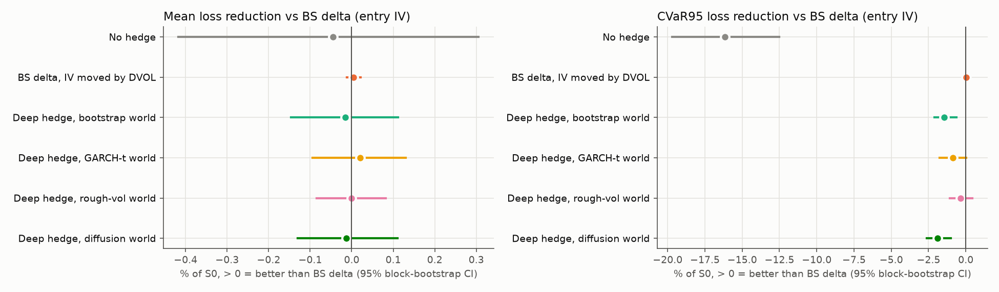

# Deep hedging BTC options: which simulated market holds up on real Deribit options?

**Headline.** On **9,527 real Deribit BTC options** that expired between January 2022 and October 2026, hedged once a
day with the Binance perpetual after fees and funding, **none of the four deep hedgers beats Black-Scholes delta** at
the option's implied vol.
- The policy trained in the **rough-volatility** world comes closest. Its CVaR95 loss is 3.98% of spot against
  3.64%; the difference is -0.34, with a 95% interval of [-1.09, +0.45], so it is not significant.
- The policy trained in the **diffusion-model** world is the worst of the four, at 5.54%. That is significantly
  worse, with an interval of [-2.63, -1.02].
- Two worlds, GARCH-t and rough vol, beat BS delta on the 2021 validation options. Neither kept that edge in
  2022-2026.

## Results

Every number comes from `results/` (`tables.md` holds all tables at three decimals). The latest test run is **run 2 of
2**: a forced rerun after a GARCH simulator fix, logged at 2026-11-21 20:24 UTC with config hash `152ac45c09422193`.
Only the GARCH row differs from run 1 (see "Run 1 vs run 2" below).

Losses are in **% of S0**, the BTC index at entry, for a short option on 1 BTC. CVaR95 is the average of the worst 5%
of losses. Δ is BS delta's loss minus the hedger's loss, so **Δ > 0 means better than BS delta**. The 95% intervals come
from a moving-block bootstrap over expiry dates: blocks of 4 expiries, 2,000 resamples.

### Test options, 1x fees (9,527 options, 251 expiries)

| Hedger | Mean P&L | Std of loss | CVaR95 loss | Δ CVaR95 vs BS delta [95% CI] | Δ mean loss vs BS delta [95% CI] | Turnover |
|---|---|---|---|---|---|---|
| No hedge | 0.15 | 6.11 | 19.80 | -16.16 [-19.69, -12.50] | -0.05 [-0.42, +0.31] | 0.00 |
| **BS delta, entry IV** | 0.20 | 1.42 | **3.64** | benchmark | benchmark | 1.63 |
| BS delta, IV moved by DVOL | 0.20 | 1.41 | 3.59 | +0.04 [-0.10, +0.20] | +0.01 [-0.01, +0.02] | 1.63 |
| Deep hedge, bootstrap world | 0.18 | 2.14 | 5.07 | -1.43 [-2.12, -0.62] | -0.02 [-0.15, +0.11] | 1.35 |
| Deep hedge, GARCH-t world | 0.22 | 1.97 | 4.51 | -0.87 [-1.76, +0.04] | +0.02 [-0.10, +0.13] | 1.56 |
| **Deep hedge, rough-vol world** | 0.20 | 1.71 | **3.98** | -0.34 [-1.09, +0.45] | -0.00 [-0.08, +0.08] | 1.54 |
| Deep hedge, diffusion world | 0.19 | 2.18 | 5.54 | -1.90 [-2.63, -1.02] | -0.01 [-0.13, +0.11] | 1.29 |



### CVaR95 loss by period, option type and fee level

Fee levels apply to the same positions; the policies are not retrained.

| Hedger | 2022-23 (3,049) | 2024 on (6,478) | Calls (4,840) | Puts (4,687) | Fees x0 | Fees x1 | Fees x2 |
|---|---|---|---|---|---|---|---|
| No hedge | 20.69 | 19.35 | 22.66 | 16.50 | 19.77 | 19.80 | 19.83 |
| BS delta, entry IV | 3.75 | 3.57 | 3.83 | 3.42 | 3.48 | 3.64 | 3.80 |
| BS delta, IV moved by DVOL | 3.69 | 3.52 | 3.82 | 3.35 | 3.44 | 3.59 | 3.75 |
| Deep hedge, bootstrap world | 5.03 | 5.09 | 5.37 | 4.75 | 4.93 | 5.07 | 5.21 |
| Deep hedge, GARCH-t world | 4.59 | 4.46 | 5.07 | 3.71 | 4.40 | 4.51 | 4.62 |
| Deep hedge, rough-vol world | 3.94 | 3.99 | 4.33 | 3.58 | 3.86 | 3.98 | 4.11 |
| Deep hedge, diffusion world | 5.56 | 5.53 | 5.88 | 5.18 | 5.40 | 5.54 | 5.68 |

The ranking holds in every column. In each split the rough-vol policy's gap to BS delta is not significant; the
bootstrap and diffusion policies are significantly worse in all four splits. The deep hedgers trade 4-21% less than BS
delta, which saves fees: at 2x fees the rough-vol policy's mean P&L (0.090) edges past BS delta's (0.086). That saving
is far smaller than what they lose in the tail.

### Simulator realism: worlds fitted on 2018-2021 vs real daily returns from 2022

| Series | Annual vol | Excess kurtosis | Mean ACF of \|r\|, lags 1-10 | 1% quantile | 99% quantile | W1, standardised |
|---|---|---|---|---|---|---|
| Real BTC, 2022 on | 0.49 | 3.2 | 0.107 | -0.082 | 0.072 | n/a |
| Bootstrap | 0.80 | 7.1 | 0.103 | -0.130 | 0.113 | 0.046 |
| GARCH-t | 0.81 | 22.1 | 0.160 | -0.122 | 0.120 | 0.105 |
| Rough vol | 0.82 | 6.7 | 0.162 | -0.126 | 0.116 | 0.046 |
| Diffusion | 0.80 | 36.6 | 0.224 | -0.124 | 0.113 | 0.172 |

- **The regime shift is large.** All four worlds learn from 2018-2021, so they are 60-70% more volatile than BTC
  was in 2022-2026 (annual vol 0.80-0.82 against 0.49).
- **The diffusion model is mixed.** Its raw return distribution is the closest to the real one (W1 0.0057, see
  `results/realism.csv`), but it has the heaviest tails and the most volatility clustering.
- **These statistics do not predict hedging quality.** Bootstrap and rough vol are equally close in standardised
  shape (0.046), yet the rough-vol policy hedges far better (3.98 vs 5.07).

### Run 1 vs run 2 (GARCH only)

| Run | Logged (UTC) | Config hash | GARCH shocks | GARCH CVaR95 loss | Δ CVaR95 vs BS delta [95% CI] |
|---|---|---|---|---|---|
| 1, official | 2026-11-19 09:41 | `d2f906a2dba41748` | uncapped Student-t | 20.15 | -16.51 [-20.78, -11.13] |
| 2, forced rerun | 2026-11-21 20:24 | `152ac45c09422193` | capped at the largest in-sample residual (8.2 sd) | 4.51 | -0.87 [-1.76, +0.04] |

**What went wrong in run 1.** In the final-stage GARCH world, one Student-t draw of about 150 sd produced a +12 daily
log return.
- The drift correction is log E[exp(r)], so that single value set it to 0.115 per day.
- Every path then fell about 97% in 35 days.
- The policy learned to barely hedge calls, and its row matched "no hedge".

**How the fix was made.** The defect shows in the simulator's own output
(`results/run1_official/simulators/final_garch.json`), not only in the test scores. The fix:
1. Truncate standardised shocks at the largest in-sample residual.
2. Redo the GARCH validation on 2021 options; alpha = 0.9 was chosen again.
3. Retrain the final GARCH policy.
4. Rerun the test with `--force`, which is logged as `forced_rerun: true`.

**Checks.**
- The other six hedgers give the same numbers in both runs, up to floating-point noise: at most 4e-9 (% of S0) in any
  summary statistic and 1e-6 in any single option's P&L.
- `tests/test_sims.py` fails on the uncapped sampler: the pipeline's own seed reproduces the 0.115 shift.

Because run 2 came after run 1 was seen, read the GARCH row as less clean than the others. The run 1 outputs are kept in
`results/run1_official/`.

### More figures

- `results/fig_pnl_distributions.png`: P&L distributions per hedger.
- `results/fig_hedge_ratio_vs_moneyness.png`: hedge ratio at entry vs moneyness, deep policies vs BS delta.

## Method

**Question.** A deep-hedging policy (Buehler, Gonon, Teichmann & Wood, *Deep hedging*, Quantitative Finance
19(8), 2019) is only as good as the market it was trained in. Four training markets are compared, and every
policy is scored on the same thing: **real expired Deribit BTC options, hedged with the Binance USDT-M perpetual,
after fees and funding**.

**Training markets** (all fitted on Binance spot BTCUSDT daily 08:00-UTC log returns from 2018-01-02; every
generator is shifted so that E[exp(r)] = 1, a driftless price, so the policies learn to hedge rather than to bet on
the 2018-2021 trend):

| World | Model | Fitted parameters (final stage, data <= 2021-12-31) |
|---|---|---|
| (a) bootstrap | stationary block bootstrap (Politis & Romano), mean block 20 days | `results/simulators/final_bootstrap.json` |
| (b) GARCH-t | GARCH(1,1), zero mean, standardised Student-t, MLE with `arch`; each path starts from an in-sample filtered variance; conditional variance capped at the in-sample maximum (the fit is integrated, alpha + beta = 1, and uncapped paths exploded); standardised shocks truncated at the largest in-sample standardised residual (run 2 onwards) | `results/simulators/final_garch.json` |
| (c) rough vol | RFSV (Gatheral, Jaisson & Rosenbaum 2018, the P-model behind rough Bergomi): log-vol is a fractional OU process; H and vol-of-vol from the regression of log E[(log sigma_{t+D} - log sigma_t)^2] on log D, D = 1..30 days, with daily realised variance from 5-minute returns; leverage rho from corr(r_t/sqrt(RV_t), d log RV_{t+1}) | `results/simulators/final_rough.json` |
| (d) diffusion | DDPM, 1D U-Net with 1.09M parameters, cosine schedule (1,000 levels), DDIM sampling (50 steps, predicted clean window clipped at +-15 sd), trained on 64-day windows of standardised daily log returns taken at all 24 hourly anchors | `results/simulators/final_diffusion.json` |

**Policy.** One MLP (3 x 64, SiLU) shared by every contract. Inputs at day t, all computed from data <= t:
log(S_t/K), time to expiry, current hedge, 10-day realised vol (annualised, from daily 08:00 returns), a call/put
flag, and z = log(S/K)/(rv sqrt(tau)) clipped to +-4 (a function of the other inputs). Output: hedge ratio in
[0, 1] for calls, [-1, 0] for puts (sigmoid). Objective: CVaR_alpha of the loss of a short option hedged with
proportional costs (0.05% per trade), Rockafellar-Uryasev form. Training contracts: maturity uniform on 7..35
days, log(K/S0) uniform on [-0.2, 0.2], half calls. 20,000 simulated 64-day paths per world, Adam, batch 4,096,
1,500 steps (about 4 minutes on a laptop CPU). The policies do **not** see implied volatility (the simulators do
not produce one), whereas the Black-Scholes benchmarks do.

**Benchmarks.** No hedge; Black-Scholes delta (r = 0) with the option's traded IV at entry; Black-Scholes delta with
that IV moved in parallel by the change in Deribit's DVOL index since entry (sigma_t = IV_0 + DVOL_t - DVOL_0).

**Rebalancing: daily at 08:00 UTC, for every hedger.** Deribit options settle at 08:00 UTC, 08:00 is a Binance
funding time, and the simulators are fitted on daily 08:00-to-08:00 returns. Hedging every 8 hours would triple the
number of trades at a 0.05% taker fee.

**Leak-free protocol.**
1. Fit the four simulators on data <= 2020-12-31, train policies with alpha in {0.5, 0.9, 0.99}, score them on
   the 2021 **validation** options (entry in 2021 and expiry <= 2021-12-31). Keep, for each world, the alpha with the
   lowest validation CVaR95 (`results/selected_hyperparameters.json`). No other choice used the data.
2. Refit every simulator on data <= 2021-12-31 and retrain the four policies with the chosen alpha.
3. Score the test period (entries from 2022-01-01) **once**, all seven hedgers in one run, logged with its
   timestamp and config hash in `results/test_log.jsonl`. The script refuses a second run unless `--force`, which
   is logged too.
4. Causality is tested: `tests/test_leak.py` scrambles every price and DVOL value after day t and checks that the
   actions up to day t do not change (deep, BS-IV and BS-DVOL hedgers).

**Frozen configuration** (`results/frozen_config.json`, config hash `152ac45c09422193`, written before the final
refit; run 1's frozen config, hash `d2f906a2dba41748`, is in `results/run1_official/`). The only tuned choice is
the CVaR level alpha of each world, picked as the lowest CVaR95 loss on the 1,388 validation options of 2021
(simulators fitted on data <= 2020):

| World | CVaR95 loss on validation, % of S0: alpha = 0.5 / 0.9 / 0.99 | Chosen alpha |
|---|---|---|
| bootstrap | 8.41 / 7.64 / **7.31** | 0.99 |
| GARCH-t (run 2; run 1 was 8.41 / **6.08** / 16.59) | 6.10 / **5.85** / 7.90 | 0.9 |
| rough vol | 6.50 / **6.30** / 6.44 | 0.9 |
| diffusion | 12.32 / 7.95 / **7.20** | 0.99 |
| *benchmark: BS delta at entry IV* | *6.63* | |

On validation two worlds (GARCH-t and rough vol, both at 0.9) already had a lower CVaR95 than BS delta; the other two
did not. Everything else (network, features, training budget, fees) was fixed in `PLAN.md` before any option was
scored.

## Data

All free, no API keys. Raw responses are cached in `~/.cache/quant-research/p1/` (a rerun downloads nothing).

| Data | Source | Use |
|---|---|---|
| Option trades 07:00-08:00 UTC, every day from 2021-01-01 | `history.deribit.com/api/v2/public/get_last_trades_by_currency_and_time` (BTC, kind=option), paged forward in time, <= 4 requests/s, retries with backoff | entry price (BTC), IV, index price |
| Delivery prices | `www.deribit.com/api/v2/public/get_delivery_prices?index_name=btc_usd` | payoff |
| DVOL | `www.deribit.com/api/v2/public/get_volatility_index_data` (hourly; history starts 2021-03-24) | BS-DVOL benchmark |
| BTCUSDT perp, 1h klines + funding | `data.binance.vision` futures/um monthly files, `.CHECKSUM` verified | hedge prices at 08:00, funding |
| BTCUSDT spot, 1h (2018-01 on) and 5-minute (2018-2021) klines | `data.binance.vision` spot monthly files, checksum verified | simulator training, realised variance |

**Option selection.** For each instrument, the last trade between 07:00 and 08:00 UTC gives the entry
(premium = trade price in BTC x the index price on that trade; entry IV = the trade's IV). Eligible: 7 to 35 days to
expiry, |log(K/S0)| < 0.2, price >= 0.0005 BTC, IV in [5%, 300%]. **One entry per instrument**, on its first
eligible day, so no option counts twice. Every payoff uses Deribit's delivery price (no fallback was needed).
The selected options are listed in `results/test_options.csv` and `results/validation_options.csv`.

**Inverse vs linear.** Deribit options are inverse: premium and payoff are paid in BTC. A call pays
(S_T - K)+/S_T BTC, worth exactly (S_T - K)+ USD at the delivery price, so the USD payoff is linear. We convert the
premium to USD at the entry index price and hedge with a linear USDT perp. Not modelled: BTC collateral (which adds
delta), margin, and the basis between the Deribit index (payoff, entry) and the Binance perp (hedge). The trade
happens up to an hour before 08:00 while the hedge starts at 08:00; that gap is the same for every hedger.

**Fees and funding** (charged in every test result unless stated):
- Deribit option taker fee: 0.03% of the underlying, capped at 12.5% of the option price, paid once at entry. The
  delivery fee is not charged (identical for all hedgers).
- Binance USDT-M taker fee: 0.05% of traded notional, on every rebalance including the first trade and the unwind
  at expiry.
- Perp funding: a position held over (t, t+1] pays position x rate x perp price at each of the three funding times
  (16:00, 00:00, 08:00 UTC).
- Fee sensitivity: both fees x0, x1, x2 at evaluation (positions unchanged, funding unchanged).

**P&L.** Short one option on 1 BTC: P&L = premium - payoff + sum_t q_t (P_{t+1} - P_t) - perp fees - option fee -
funding, divided by S0 (index at entry) and shown in **% of S0**. Loss = -P&L. The same function computes the
training loss and the real backtest (`src/dh/accounting.py`).

## What is new

Deep hedging has mostly been evaluated inside simulated markets. Related work that uses generative models as the
training market:
- Tanaka et al., *CoFinDiff: Controllable Financial Diffusion Model for Time Series Generation*, arXiv:2503.04164
  (2025). The abstract reports that training on CoFinDiff-generated data improves performance in a deep-hedging task;
  it does not describe a test on real traded options with fees.
- Aghapour, Bayraktar & Yuan, *Dynamic data generation and dynamic portfolio selection: an application of a
  score-based diffusion model*, arXiv:2507.09916 (2025). A score-based diffusion model generates training scenarios
  for dynamic mean-variance portfolio selection (not option hedging), tested on synthetic and real market data.
- Tiwari, *Generative Diffusion Model for Risk-Neutral Derivative Pricing*, arXiv:2603.20582 (2026). A drift shift in
  the reverse diffusion gives martingale (risk-neutral) paths for pricing; the abstract reports tests against a GBM
  benchmark and does not mention hedging.

What this project adds: the same deep-hedging policy is trained in four markets (bootstrap, GARCH-t, rough vol,
diffusion) and **each one is scored on about 9,500 real expired BTC options with real fees, funding and settlement
prices**, against Black-Scholes deltas that use the market's implied vol, with block-bootstrap confidence
intervals grouped by expiry date. It is a small, honest comparison, not a new hedging method.

## Limits (read before quoting a number)

- **Information gap.** The deep hedgers see realised vol only; the Black-Scholes benchmarks see the option's implied
  vol, which is the market's own forecast. A simulated market has no implied vol to train on. This is the main
  reason a 10-day realised-vol policy can lose to "BS delta at the entry IV".
- **Regime shift.** The simulators are fitted on 2018-2021 (BTC vol ~80% a year); the test period 2022-2026 is
  calmer (see the realism table). The policies get realised vol as an input, but they extrapolate.
- **One seed per policy.** Each policy is trained once (fixed seed). Differences between two deep hedgers that sit
  inside each other's bootstrap interval should not be read as a ranking.
- **Execution.** Option premium = the last traded price in 07:00-08:00 UTC (both buyer- and seller-initiated
  prints; no extra bid-ask cost beyond the fee). The perp trades at the 08:00 hourly open, no slippage. The hedge
  starts at 08:00, up to an hour after the option trade; this gap is identical for every hedger.
- **Not modelled.** BTC collateral of an inverse option account, margin, the Deribit-index vs Binance-perp basis,
  the option delivery fee, intraday rebalancing. Fee sensitivity (x0, x2) re-prices the same positions; the
  policies are not retrained for each fee level.
- **Fits.** The 2018-2021 GARCH-t fit is integrated (alpha + beta = 1) with nu close to 3, so the GARCH world has
  very heavy tails. The diffusion model learns from about 1,450 days (heavily overlapping 64-day windows);
  memorisation was not measured. Rough-vol H is estimated from daily 5-minute realised variance, which includes the
  weekday/weekend pattern of BTC activity.
- **Sample end.** Binance publishes funding as monthly files only, so the test stops at expiries on or before
  2026-10-31.

## Simplifications and fixes made during the build

All but one were made before the first test run, on training or validation data only. The exception is the GARCH
shock cap, made after run 1 (see "Run 1 vs run 2"). `PLAN.md` ("Changes during the build") has the details.

- **GARCH shock cap (after run 1).** Standardised Student-t shocks are truncated at the largest in-sample standardised
  residual (7.8 sd for data <= 2020, 8.2 sd for <= 2021). The GARCH validation, final policy and test were redone.

- **Compute budget.** Policies: batch 4,096, 1,500 Adam steps, 20,000 paths per world, three CVaR levels on
  validation. Diffusion: 1.09M parameters (smallest size in the 1-5M brief), 8,000 steps of batch 128, DDIM with 50
  steps. One seed per policy.
- **GARCH variance cap.** The integrated GARCH-t fit produced exploding paths (daily log returns above 10); the
  conditional variance is now capped at its in-sample maximum.
- **Rough vol in RFSV form.** The non-stationary rBergomi form (flat forward variance, no mean reversion) gave
  64-day paths with excess kurtosis ~224; the stationary RFSV model of GJR 2018 with a small mean reversion fitted to
  the dispersion of log-vol is used instead (H and vol-of-vol still from the GJR regression).
- **Diffusion sampler clipping.** Unclipped DDIM sampling blew up (alpha_bar = 2.4e-9 at the last noise level); the
  predicted clean window is clipped at +-15 training standard deviations.
- **Thin slice on validation, not test,** so that the test period is scored exactly once.
- **No implied-vol input** to the deep hedgers (optional in the brief): the simulated worlds have no implied vol.
- **Daily rebalancing only**; no 8-hour variant.

## How to run

Windows 11, Git Bash, `uv` 0.12, CPU only.

```bash
git clone https://github.com/mohymabrouk/deep-hedging-sim-to-real.git
cd deep-hedging-sim-to-real
uv sync                                                     # Python 3.12 venv, CPU torch (lockfile: uv.lock)
export PYTHONIOENCODING=utf-8
uv run python -m dh.cli download                            # ~10 min the first time, then cached
uv run python -m dh.cli build                               # option table: results/test_options.csv, validation_options.csv
uv run python -m dh.cli validate                            # fit <= 2020, alpha in {0.5, 0.9, 0.99}, score 2021 options
uv run python -m dh.cli final                               # refit <= 2021, retrain with chosen alpha, realism table
uv run python -m dh.cli test                                # the single test run (logged; refuses to rerun without --force;
                                                            #   already run twice here, so a rerun needs --force)
uv run python -m dh.cli report                              # tables.md, realism.csv, figures
uv run pytest                                               # tests
```

`validate --only bootstrap,garch,rough` and `validate --only diffusion` split the validation work across two
processes (that is how it was run here, with `OMP_NUM_THREADS=4` each). Logs go to `logs/`.

## Files

- `PLAN.md`: the plan written before coding, with the changes made during the build.
- `src/dh/`: `download.py`, `deribit.py`, `binance.py` (data); `dataset.py` (options); `market.py` (08:00 series,
  funding); `accounting.py` (P&L); `hedging.py` (hedgers, causal loop, deep-hedging training); `sims.py`
  (bootstrap, GARCH, rough vol, realism statistics); `diffusion.py`; `evaluate.py` (metrics, block bootstrap);
  `pipeline.py` (protocol stages); `report.py`.
- `results/`: `performance_test.csv`, `performance_splits.csv`, `fee_sensitivity.csv`, `realism.csv`,
  `test_pnl_per_option.csv`, `validation/`, `simulators/`, `selected_hyperparameters.json`, `test_log.jsonl`,
  `tables.md`, figures `fig_*.png`. `run1_official/`: every output of test run 1 (before the GARCH fix).
- `tests/` (21 tests): accounting (BS delta on GBM), deep hedger recovers BS delta on GBM, delivery/payoff mapping,
  inverse-to-USD, leak test, put-call parity on a saved Deribit snapshot, and `test_sims.py` (no simulated world can be
  dominated by one draw: martingale shift and path-collapse checks over six seeds, on synthetic and real BTC fits).
